

<a href="https://www.rivelya.com">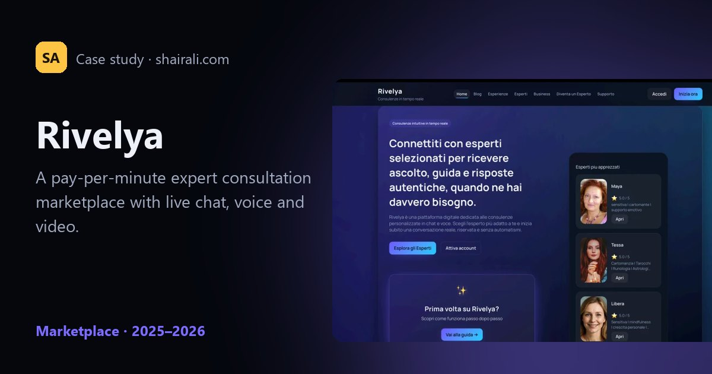</a>

# Rivelya

**A pay-per-minute expert consultation marketplace with live chat, voice and video.**

 

Marketplace · Rivelya · Italy · Nov 2025 – Apr 2026

> [!NOTE]
> This repository is a **showcase**. The source code is private and belongs to the client, so this page documents what I built, how it works and the stack behind it. Screenshots are from the live product.

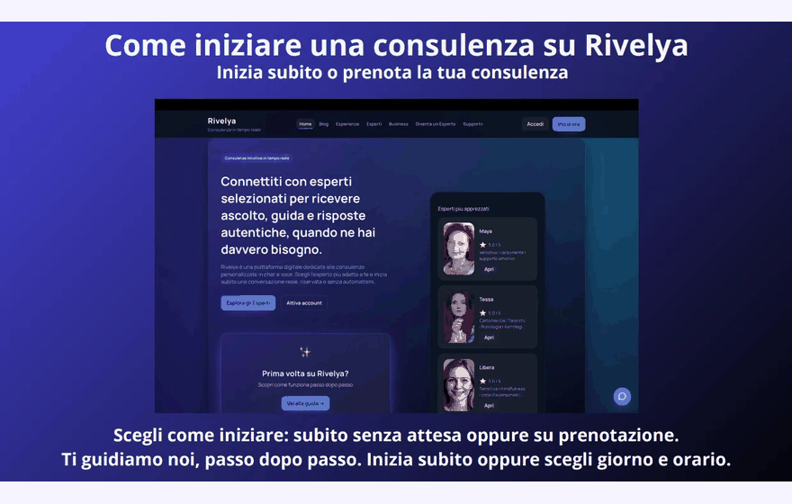

## Overview

An Italian marketplace where clients top up a wallet and consult verified experts by chat, voice or video, billed by the minute, booked ahead or started on demand.

| | |
|---|---|
| **Role** | Solo full-stack developer: product, frontend, backend, infrastructure & DevOps |
| **Client** | Rivelya · Italy |
| **Timeline** | Nov 2025 – Apr 2026 |
| **Live** | [rivelya.com](https://www.rivelya.com) |

## At a glance

<table><tr>
<td align="center" width="25%"><h3>1,250+</h3>Commits, all mine</td>
<td align="center" width="25%"><h3>180+</h3>API endpoints</td>
<td align="center" width="25%"><h3>29</h3>Data models</td>
<td align="center" width="25%"><h3>3</h3>Live channels: chat, voice, video</td>
</tr></table>

## The challenge

Minute-based consultations are a high-volume, trust-sensitive business. The client needed a platform that could match clients with available experts instantly, meter every session precisely, collect payment upfront, hold and settle expert earnings and do all of it reliably in real time, without anyone reconciling balances by hand.

## What I built

I built Rivelya from scratch as a one-developer product: a React app for clients, experts and admins; an Express and Socket.io backend; self-hosted LiveKit for WebRTC voice and video; and a billing engine on MongoDB transactions that the server controls. The server starts, meters and closes every session, so the money is always right, even when a browser tab isn't.

## Key features

### Instant or scheduled sessions

Expert presence updates live. Clients can start a session immediately (the expert has 30 seconds to accept) or book a slot from the expert's availability calendar. A scheduler auto-starts booked sessions on time, in the Europe/Rome timezone.

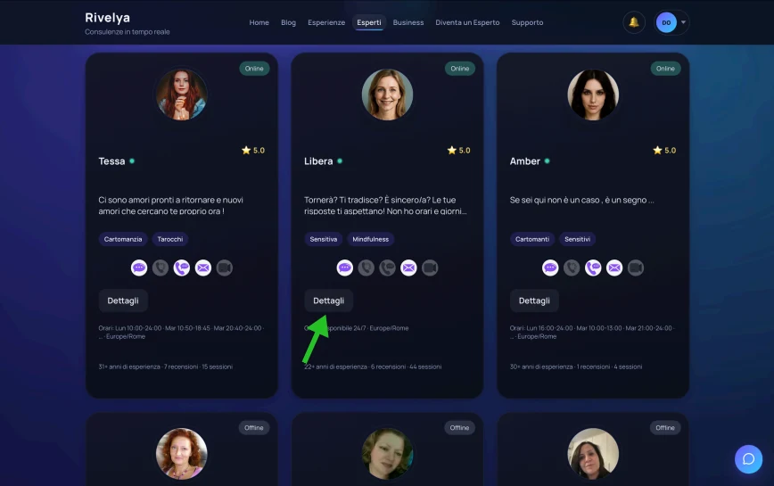

### Chat, voice and video in one place

Socket.io powers chat, typing indicators, presence and call signalling. Voice and video run on a self-hosted LiveKit server with a TURN relay, with Twilio as a phone fallback. A live countdown shows each client exactly how much time is left.

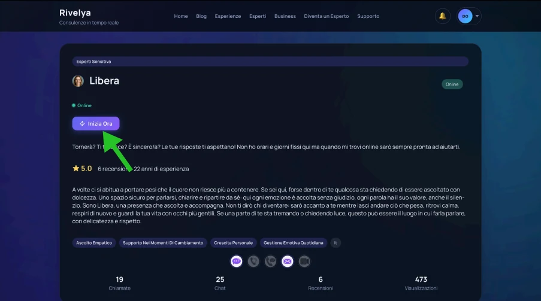

### Wallet and per-minute billing that can't drift

Stripe Payment Intents with verified webhooks top up a prepaid wallet held in integer cents. Every balance change runs in an atomic MongoDB transaction with idempotent payment handling, and negative balances are blocked. Expert earnings sit on a 7-day hold before they become withdrawable.

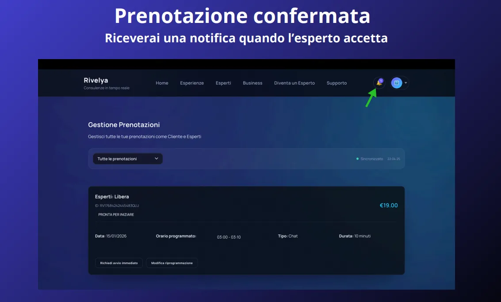

### Expert and admin consoles

Invite-only expert onboarding with availability, rates, earnings and withdrawal requests. The admin console has an OTP login and covers commission per expert, payouts, CMS and blog, testimonials and promotional email campaigns.

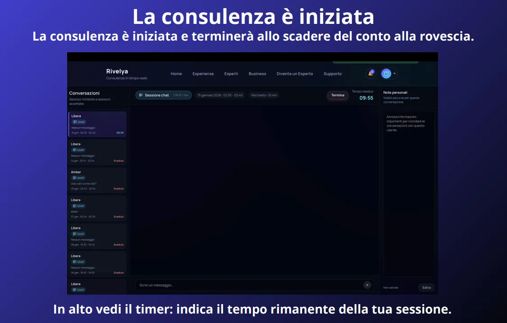

## User journey

A client's path from landing page to a rated session, step by step.

<table>
<tr>
<td width="33%" valign="top"> <b>1. Start a consultation</b> Start right away or book a time. The flow guides the client step by step.</td>
<td width="33%" valign="top">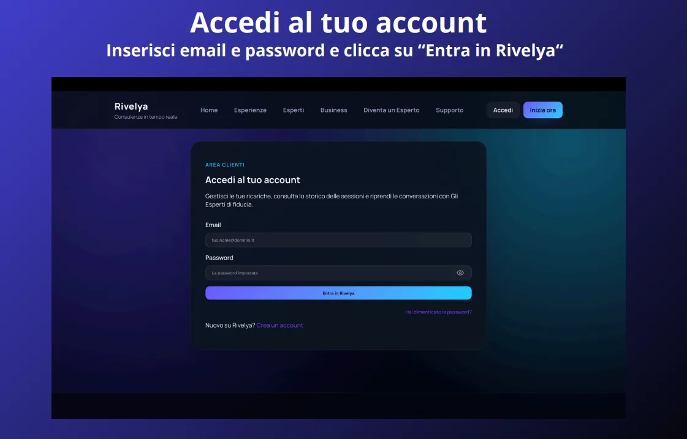 <b>2. Sign in</b> Email and password, or Google sign-in, with phone verification before the first booking.</td>
<td width="33%" valign="top"> <b>3. Open the expert directory</b> The Experts menu lists everyone who is available right now.</td>
</tr>
<tr>
<td width="33%" valign="top">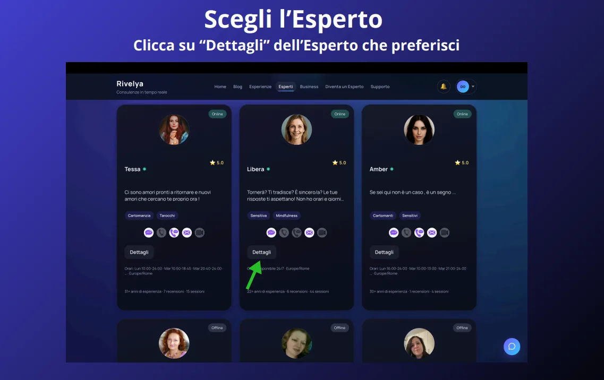 <b>4. Choose an expert</b> Clients compare ratings, specialities and channels, then open the profile.</td>
<td width="33%" valign="top">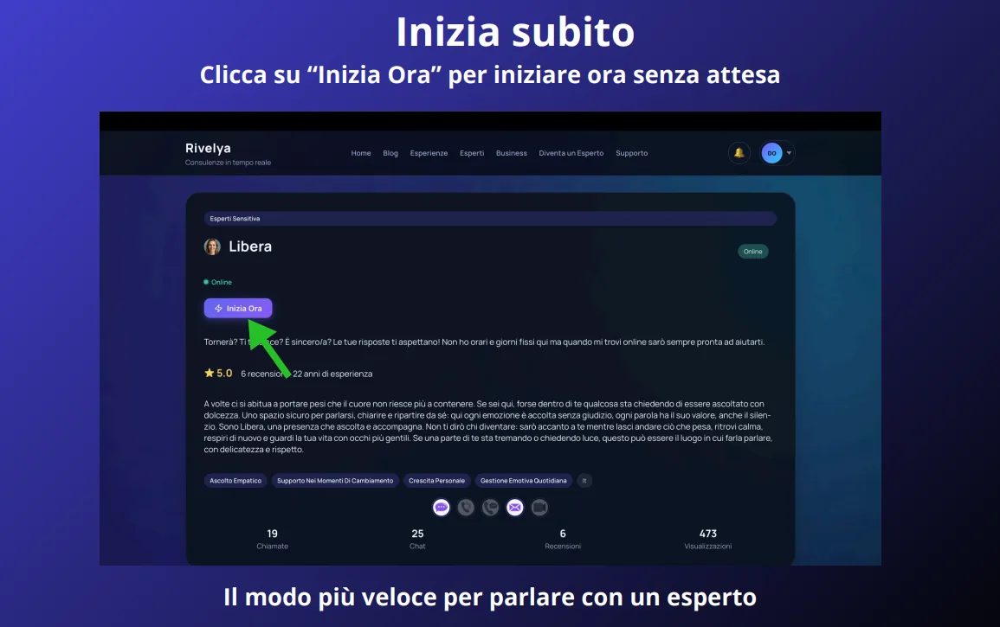 <b>5. Start now</b> One click on Start now. It's the fastest way to talk to an online expert.</td>
<td width="33%" valign="top">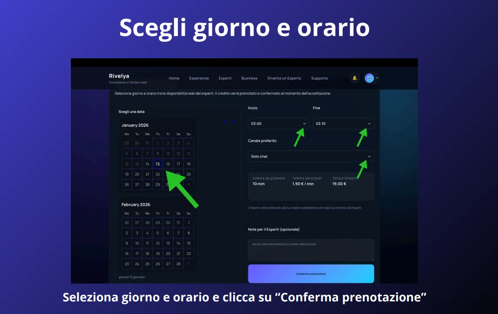 <b>6. Or pick a day and time</b> Date, time slot and channel. Price and duration are calculated live.</td>
</tr>
<tr>
<td width="33%" valign="top">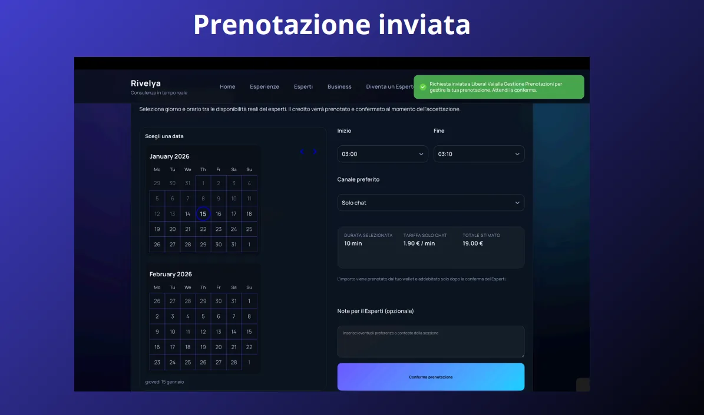 <b>7. Booking sent</b> The request goes to the expert, and the amount is charged upfront.</td>
<td width="33%" valign="top">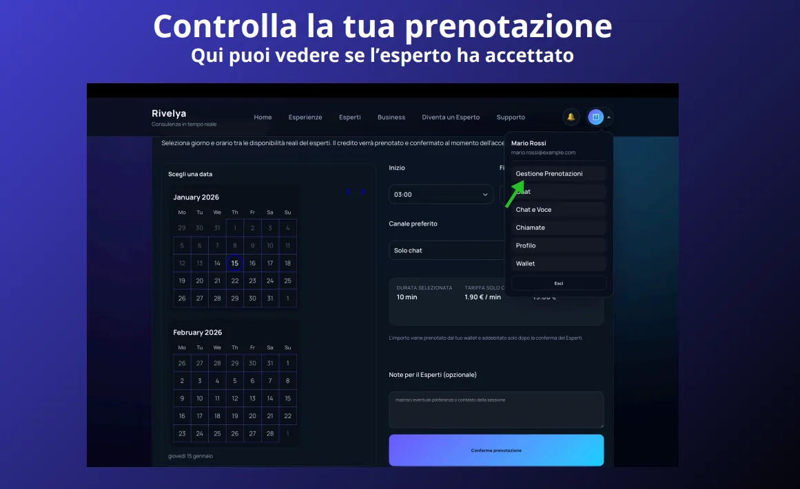 <b>8. Track the booking</b> Booking management shows whether the expert has accepted.</td>
<td width="33%" valign="top">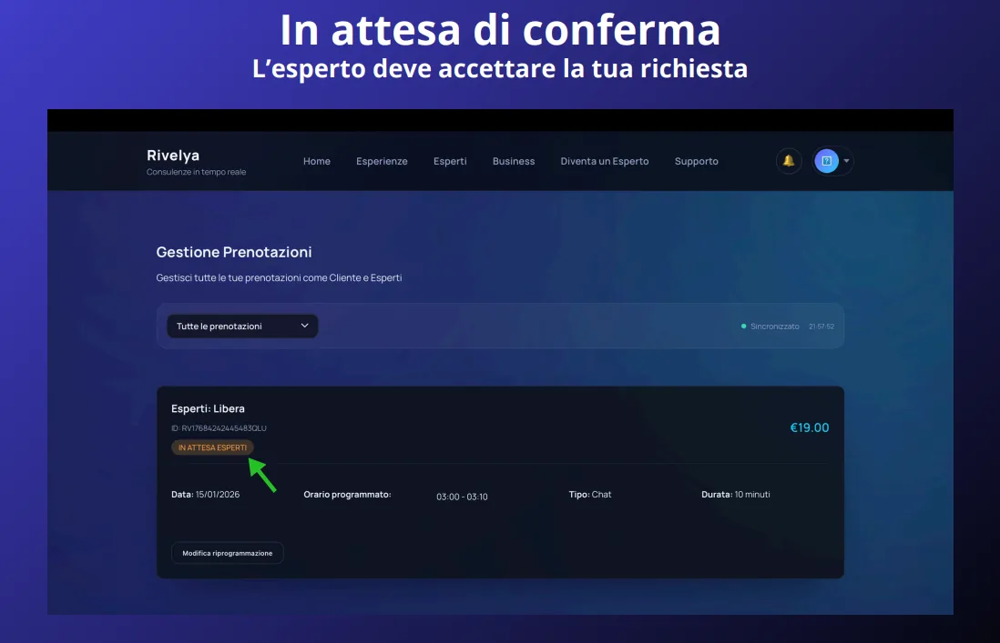 <b>9. Awaiting confirmation</b> If the expert rejects, the client is refunded automatically.</td>
</tr>
<tr>
<td width="33%" valign="top"> <b>10. Booking confirmed</b> A real-time notification arrives as soon as the expert accepts.</td>
<td width="33%" valign="top">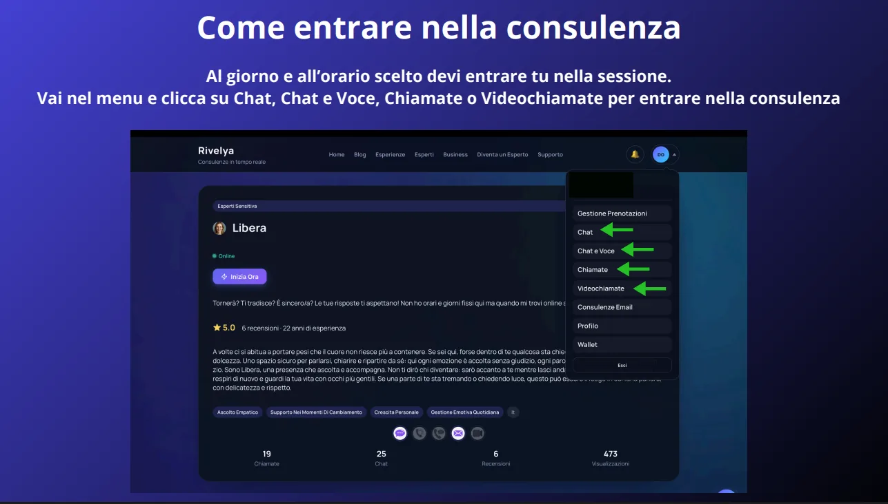 <b>11. Join the session</b> At the scheduled time, the client joins by chat, chat and voice, call or video.</td>
<td width="33%" valign="top"> <b>12. Session in progress</b> A server-controlled countdown shows the time remaining.</td>
</tr>
<tr>
<td width="33%" valign="top">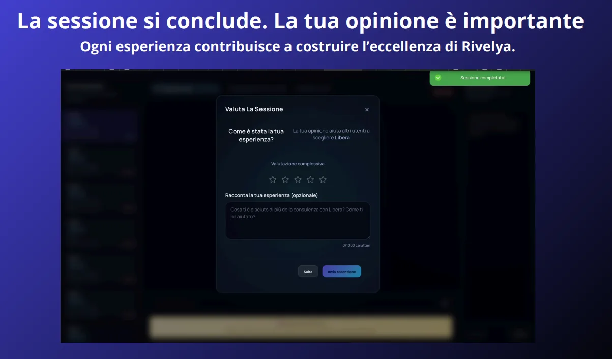 <b>13. Rate the session</b> After the session, the client leaves a rating that feeds the expert's stats.</td>
</tr>
</table>

## Architecture

```mermaid
flowchart LR
  subgraph L0["Client"]
    direction TB
    L0_0["React SPA for clients, experts and admins"]
    L0_1["Socket.io client"]
    L0_2["LiveKit client"]
    L0_3["Stripe Elements"]
  end
  subgraph L1["Edge"]
    direction TB
    L1_0["Nginx on AWS EC2"]
    L1_1["HTTPS"]
    L1_2["Static build + /api & websocket proxy"]
  end
  subgraph L2["Application"]
    direction TB
    L2_0["Express REST API"]
    L2_1["Socket.io realtime hub"]
    L2_2["Cron session scheduler & metering"]
    L2_3["PM2 process manager"]
  end
  subgraph L3["Data & services"]
    direction TB
    L3_0["MongoDB Atlas (transactions)"]
    L3_1["AWS S3 media"]
    L3_2["Stripe"]
    L3_3["LiveKit SFU + TURN"]
    L3_4["Twilio Verify"]
    L3_5["Resend email"]
    L3_6["Groq / Gemini assistant"]
  end
  L0 --> L1
  L1 --> L2
  L2 --> L3
```

## Engineering highlights

- The server is the source of truth for billing: cron jobs start, meter and end sessions, and timers in the browser are display-only.
- Payments are protected against duplicates with a unique index on the payment intent, a check before processing and atomic transactions.
- Security: Helmet headers, rate limiting, verified Stripe webhooks, OTP admin sessions, KYC middleware and no direct S3 URLs.
- GDPR: cookie consent, account deletion with OTP confirmation, and media served through an authenticated proxy with WebP conversion.
- Push-to-deploy CI/CD with GitHub Actions: SSH, install, build and restart PM2 with no downtime.
- Built-in AI support assistant using Groq Llama 3.1, with Gemini as a fallback.

## Tech stack

| Area | Technologies |
|---|---|
| **Frontend** |       |
| **Backend** |      |
| **Data** |    |
| **Integrations** |  -333333?style=flat-square&logo=webrtc&logoColor=white)     |
| **Infrastructure** |     |

## About the developer

Designed, built and deployed by **[Shair Ali](https://shairali.com)**, a full-stack developer who owns products end to end: architecture, interface, API, data, payments, servers and CI/CD.

   

Have a similar project? [Get in touch](https://shairali.com/contact).
